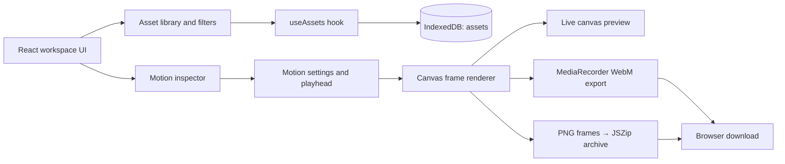

# Framevault — Visual Timeline Asset Vault & Export Studio

## Problem Statement

Motion designers and video editors often keep overlays, lower-thirds, timeline accents, and callouts scattered across folders. Finding the right treatment, making a quick variation, and producing a reviewable render can interrupt an edit. Framevault brings a small, searchable asset kit and a configurable motion preview into one local-first browser workspace.

## Target Users

- Video editors who need reusable overlays and timeline details at hand.
- Motion designers preparing title treatments, callouts, and short transitions.
- Independent creators who want to preview and export simple motion studies without a desktop render round-trip.

## Key Workflows

1. **Find and organize a kit.** Browse Overlays, Timeline accents, and Callouts. Search by asset name, tags, format, or aspect ratio. Add an asset record with an optional PNG, JPEG, or WebP source image (validated and limited to 50 MB), and assign or remove tags; library records, local image data, and tag changes persist in IndexedDB on the current browser.
2. **Shape a motion preview.** Select an asset and edit its headline, supporting copy, stroke color, motion blur, and in/out markers. Scrub or play the five-second canvas loop and inspect its title/subtitle timeline lanes.
3. **Render for an edit.** Export a five-second browser-recorded WebM or a ZIP of PNG frames. Progress is surfaced while recording/encoding, unsupported recording formats are reported, and export failures (including memory guardrails) appear in the workspace.

## Tech Stack

- React 18, TypeScript, and Vite
- Tailwind CSS 4 (Vite plugin), with focused studio-specific CSS
- Lucide React icons
- IndexedDB for local asset metadata, imported image blobs, and tag persistence
- HTML Canvas 2D, `MediaRecorder`, `canvas.captureStream()`, and JSZip for client-side exports

## Local Setup

Requirements: Node.js 20.19+ or 22.12+ and npm.

```bash
npm install
npm run dev
```

Open the local URL printed by Vite. The starter asset kit is initialized into IndexedDB on first launch. Asset metadata, imported images, and tag edits stay in this browser and are not uploaded.

Production build and preview:

```bash
npm run build
npm run preview
```

WebM recording depends on the codecs exposed by the browser. The PNG sequence export is a ZIP containing 60 frames at 12 FPS. The canvas is rendered at 1280 × 720 (16:9); browser recording capability and memory vary by device.

## Architecture



The UI is composed in `src/App.tsx`. `src/hooks/useAssets.ts` owns database initialization and asset mutations, while `src/hooks/useMotionCanvas.ts` owns deterministic canvas drawing. `src/lib/export.ts` turns that frame renderer into WebM recordings and PNG sequence archives. A top-level error boundary and explicit export states keep failures visible rather than silently falling back.
